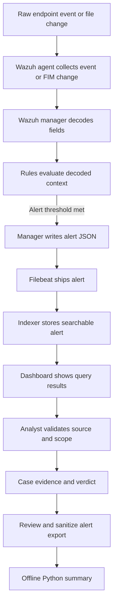

# Event collection and investigation

| Term | Meaning in this lab | Example and verification |
| --- | --- | --- |
| Raw event | Record at its original source, or original file operation for FIM | A Windows 4625 Security record with a UTC time, or a change to a disposable monitored file |
| Collected event | Selected record or FIM observation forwarded to the manager by an agent | Match the agent, time and relevant source fields to the collection configuration |
| Security alert | Rule output meeting the manager alert settings | Verify rule ID, severity, triggering fields and actual alert timestamp. Filebeat delivers eligible alerts to the indexer |
| Security incident | Analyst determination that evidence meets a defined incident criterion | An unapproved change with corroborating identity and timeline. A benign, authorized change may close the alert |
| Investigation evidence | Referenced observations supporting or challenging a claim | Redacted source excerpt, alert ID and query window, approved-change note and UTC chronology with confidence |

## Trace an observation

1. Record the source time, agent alias, event/tag/path, audit prerequisites and expected fields. Keep credentials and command lines containing sensitive values private.
2. Verify collection at the source and manager. A received event may have no matching alert or fall below the alert threshold. The default alert index alone cannot establish completeness of raw event collection.
3. For a detector, record expected rule ID, actual match and the searchable index time separately. If the source exists but search fails, check collection, decoded fields, rule level, Filebeat delivery, indexing and the dashboard time filter in that order.
4. In triage, link the alert to supporting events with a bounded UTC window. Record alternatives, impact, verdict, confidence and cleanup. A case may finish as benign or inconclusive.
5. Retain minimal approved evidence outside Git first. Export only the fields needed for the case and offline reporting, use lab aliases, review the sample, and then link the reviewed evidence ID from the case. Reports contain counts and references to the sample.
6. The approved searchable-alert target is seven days. Assess growth before tuning retention. Any temporary raw archive needs a defined purpose, local access controls, a short retention decision and a documented cleanup.

See the [official event logging guide](https://documentation.wazuh.com/current/user-manual/manager/event-logging.html), [Wazuh component architecture](https://documentation.wazuh.com/current/getting-started/architecture.html) and [test metrics](../PROJECT_SPEC.md).
