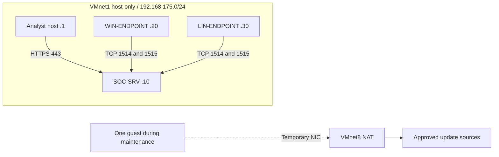

# Lab network design

Use VMware VMnet1 for persistent host-only connectivity and VMnet8 temporarily for package installation and updates. The host is a member of the lab segment and must retain its firewall. The following design reflects configuration inspected on 27 November 2026. The owner approved the topology. Runtime isolation remains a Phase 02B test.

## Address decisions

| Role | Lab address | Status |
| --- | --- | --- |
| Analyst host | 192.168.175.1/24 | Present on VMnet1 and reserved in DHCP configuration |
| SOC-SRV | 192.168.175.10/24 | Candidate static address |
| WIN-ENDPOINT | 192.168.175.20/24 | Candidate static address |
| LIN-ENDPOINT | 192.168.175.30/24 | Candidate static address |

VMware's `netmap.conf` maps VMnet1 to HostOnly and VMnet8 to NAT. The Workstation registry has adapter and DHCP sections for VMnet1, plus a NAT section for VMnet8. `vmnetnat.conf` selects VMnet8. Its incoming TCP/UDP sections contain zero active forwarding entries. Windows reports IPv4 forwarding disabled on both VMnet adapters.

The VMnet1 DHCP pool is 192.168.175.128–192.168.175.254. The guest candidates fall below the pool and are distinct from the host address. The DHCP configuration lists the host reservation. The inspected DHCP leases file and Windows IPv4 neighbor cache contained zero entries for the three candidates. The host route table showed the VMnet1 subnet on VMnet1 only and no overlapping connected Wi-Fi, WSL or VMnet8 prefix at inspection time. An offline static guest or a future VPN may still cause a conflict. Recheck at assignment time.

## Traffic policy

| Initiator | Destination | Protocol and port | Purpose and exposure |
| --- | --- | --- | --- |
| Windows/Linux agent | Manager lab address | TCP 1514 | Agent communications, limited to lab guests |
| Windows/Linux agent | Enrollment service on manager | TCP 1515 | Initial key enrollment or authorized re-enrollment |
| Analyst host on VMnet1 | Dashboard lab address | HTTPS TCP 443 | Browser access. Verify lab certificate identity, restrict inbound by source |
| Analyst host on VMnet1 | Linux guest | SSH TCP 22 | Optional administration using a protected key, only when needed |
| Filebeat on SOC-SRV | Indexer on the same guest | HTTPS TCP 9200 | Ingest alerts using TLS and service credentials |
| Dashboard on SOC-SRV | Indexer / manager API on the same guest | HTTPS TCP 9200 / 55000 | Search / agent status and management. Keep off guest-facing and NAT interfaces where possible, otherwise restrict by firewall |
| One maintenance guest | Approved update endpoints via VMnet8 | HTTPS TCP 443 and DNS UDP/TCP 53 to the configured resolver | Outbound only during maintenance. If the selected OS requires another repository transport, review the source first |

Single-node deployment requires no external cluster ports. Keep the lab NIC without a default gateway. Disconnect the temporary NAT NIC and its auto-connect setting before a simulation, confirm guest routes (IPv4 and IPv6) and restrict guest-to-host services. Disable guest shared folders and clipboard for test sessions unless specifically required. Do not bridge, configure inbound port forwarding or enable host routing/Internet Connection Sharing. NAT gives guests outbound reach only during a maintenance window.

## Verification at handover

1. To inspect manually, open VMware Workstation > Edit > Virtual Network Editor. View VMnet1 type/subnet and DHCP Settings, then VMnet8 type and NAT Settings. Compare against the table, view port forwarding and exit with Cancel. If editing requires elevation, the owner can review before authorizing any change.
2. Before assigning each address, reconcile the owner's existing VM/static inventory, leases, host addresses and active routes (including VPN if it will be used). Verify guest duplicate-address detection and start one guest at a time. If occupied, record a replacement below the DHCP pool and update this plan.
3. In Phase 02, inspect each guest's adapters, routes, DNS and host-side sharing, including IPv6. Verify intended host-only reachability, no egress to the physical LAN or Internet during simulation and no unintended host service access. Record sanitized results and snapshots.
4. After services exist, test the allowed socket from its intended source and a denied path from another lab role. Confirm enrollment/data in Phase 04. A ping alone does not verify dashboard, TLS, enrollment or isolation.

[Wazuh service ports and directions](https://documentation.wazuh.com/current/getting-started/architecture.html) · [Broadcom network types](https://knowledge.broadcom.com/external/article/309842/) · [Isolation decision](decisions/ADR-003-network-isolation.md).
