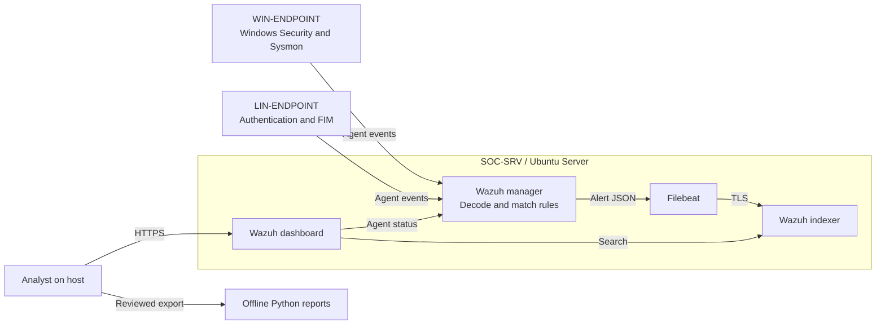

# SOC Home Lab system architecture

Two endpoint operating systems produce different evidence for one analyst. The Windows guest supplies account, authentication, scheduling and process records. The Linux guest supplies authentication and file integrity records. One server joins the two streams by agent, rule and time. The analyst can follow a record from the guest to a decision and reproduce the case with a sanitized evidence set.

| Boundary | Responsibility | Operational check for the relevant phase |
| --- | --- | --- |
| Lab endpoints | Audit policy, Sysmon selection, Linux authentication source, FIM baseline, agent delivery | Check active agent, source record and timestamp. Deduplicate journal/auth.log collection |
| SOC-SRV | Enrollment, decoding, rules, alert file, transport, indexing and dashboard | Verify services after reboot, match rule output to the indexed record, check disk growth |
| Host analyst | Query the dashboard, correlate records and document the verdict | Restrict dashboard access to the host lab interface, verify the certificate and record the query window |
| Offline reporting | Read an approved, minimized export and summarize groups to CSV/Markdown | Unit-test counts, malformed rows and safe output before sharing |
| Publication | Publish reviewed configuration excerpts and labeled evidence | Verify that a reader can follow a test and reproduce its outcome with lab data |

Deploy SOC-SRV, then Linux, then Windows, then test integration. Keep each guest's disk independent. A single central guest saves memory and removes inter-VM cluster traffic. Its failure affects collection, search and the dashboard together. Plan a clean baseline and a restore rehearsal. Windows and Linux can be tested in separate sessions if memory limits concurrent operation.

See [network flows](network-design.md), [data definitions](data-flow.md), [guest sizing](resource-allocation.md) and [acceptance tests](../PROJECT_SPEC.md). Rationale is recorded in [ADR-001](decisions/ADR-001-virtualization.md), [ADR-002](decisions/ADR-002-siem-platform.md) and [ADR-003](decisions/ADR-003-network-isolation.md).
